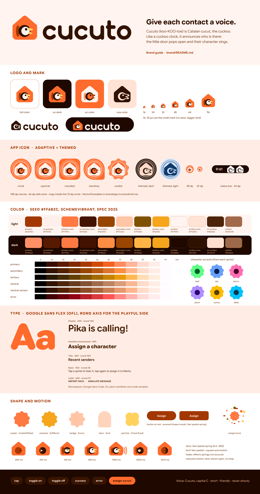

<p align="center"></p>

# Cucuto brand guide



## Concept

**Cucuto** (koo-KOO-toe) comes from Catalan *cucut*, the cuckoo. Like a cuckoo clock, it announces who is there:
when a contact messages, the little round door pops open and their character sings.

The mark is that clock: a warm tangerine house, its round door swung open, and a bird leaning out with its beak
open mid-call. It is built only from Material shapes (a rounded pentagon, circles, rounded triangles), so it sits
naturally next to Material 3 Expressive UI, and it plays like a small game: the door opens, the bird pops out,
"cu-cu!".

Every asset here is original, drawn by hand in code (`tools/geometry.mjs`) and generated by the scripts in
`tools/`. No third-party artwork. Brand assets are part of the repository under GPL-3.0-or-later; the UI sounds are
CC0-1.0.

## Logo

| Asset | Files | Use |
| --- | --- | --- |
| Logo (mark + wordmark) | [`cucuto-logo.svg`](logo/cucuto-logo.svg) (adapts to dark mode), [`-light`](logo/cucuto-logo-light.svg), [`-dark`](logo/cucuto-logo-dark.svg), [`-on-color`](logo/cucuto-logo-on-color.svg), [`-mono`](logo/cucuto-logo-mono.svg) | README, website header, social |
| Mark | [`cucuto-mark.svg`](logo/cucuto-mark.svg), [`-on-color`](logo/cucuto-mark-on-color.svg), [`-mono`](logo/cucuto-mark-mono.svg) | Avatars, app surfaces, anywhere square |
| Small mark | [`cucuto-mark-small.svg`](logo/cucuto-mark-small.svg) | 16–32 px only (favicons): no door, bigger bird and eye |
| Wordmark | [`cucuto-wordmark.svg`](logo/cucuto-wordmark.svg) (adapts), [`-light`](logo/cucuto-wordmark-light.svg), [`-dark`](logo/cucuto-wordmark-dark.svg), [`-mono`](logo/cucuto-wordmark-mono.svg) | When the mark is already nearby |

- **Variants.** *Full color* works on white, cream and dark backgrounds. *On color* (cream house, tangerine bird)
  goes on tangerine or other saturated brand color. *Mono* uses `currentColor`: set the CSS `color` (black, white,
  walnut) and it follows; use it for one-color printing, embossing, watermarks.
- **Wordmark.** Lowercase "cucuto", constructed from one round-capped monoline stroke (no font needed). The
  lockup aligns the wordmark's x-height with the eaves of the house and its baseline with the floor.
- **Clear space.** Keep free space around the logo equal to the **door diameter** (about 40 % of the mark's
  height) on every side.
- **Minimum size.** Mark: 16 px (use the small mark from 16 to 32 px). Logo: 24 px tall (about 100 px wide).
  Wordmark: 12 px x-height.
- **Don't** change the colors outside the given variants, outline it, add shadows or gradients, rotate it,
  stretch it, put the full-color mark on tangerine (use *on color*), recreate the wordmark in a font, capitalize
  it ("Cucuto", "CUCUTO"), or put the bird's beak facing left.

## App icon

Android adaptive icon (108 dp canvas, 72 dp viewport, 66 dp safe zone) as VectorDrawables, ready to copy:

```
cp -r brand/app-icon/android-res/* android/app/src/main/res/
```

- `drawable/ic_launcher_background.xml`: flat tangerine.
- `drawable/ic_launcher_foreground.xml`: the on-color mark, 43.5 dp wide, inside two **sound rings**: concentric
  with the icon's center (radii 25.5 and 31 dp, apricot fading to the door's tint), the voice spreading out of the
  clock. The outer ring ends 3.5 dp inside the 72 dp circle, so every launcher mask (circle, squircle, rounded
  square, teardrop, cookie) shows the same two whole rings and never a stray arc. They sit in the foreground,
  locked to the house, so launcher motion cannot pull them off-center.
- `drawable/ic_launcher_monochrome.xml`: one-color silhouette for themed icons (Android tints it), with the rings
  at 50 % and 30 % alpha.
- `drawable/ic_stat_cucuto.xml`: the **status-bar notification icon**, 24 dp, white on transparent, the small
  mark's silhouette (bigger bird, no door) filling the 22 dp live area. Use it for every notification Cucuto posts;
  never the launcher layers (their glyph fills only the 66 dp safe zone of a 108 dp canvas, so it renders at about
  half the size of other apps' icons).
- `mipmap-anydpi/ic_launcher.xml` and `ic_launcher_round.xml`: `<adaptive-icon>` with `<monochrome>`. No `-v26`
  qualifier and no bitmap mipmaps: `minSdk` is 37.
- Manifest: `android:icon="@mipmap/ic_launcher"` and `android:roundIcon="@mipmap/ic_launcher_round"`.

Sources are in [`app-icon/source/`](app-icon/source). [`cucuto-icon-512.png`](app-icon/cucuto-icon-512.png) is the
full-bleed square (store/avatar style, the platform masks it) and
[`cucuto-icon-rounded-512.png`](app-icon/cucuto-icon-rounded-512.png) is pre-rounded for places that show the file
as is (GitHub, the website). Both also as `.jxl`.

## Web

| File | Use |
| --- | --- |
| [`favicon.svg`](web/favicon.svg), [`favicon.ico`](web/favicon.ico) (16 + 32) | Browser tab |
| [`apple-touch-icon.png`](web/apple-touch-icon.png) (180, opaque) | iOS home screen |
| [`icon-192.png`](web/icon-192.png), [`icon-512.png`](web/icon-512.png) | PWA `purpose: any` |
| [`icon-maskable-512.png`](web/icon-maskable-512.png) | PWA `purpose: maskable` (mark and rings inside the 80 % safe circle) |
| [`og-image.png`](web/og-image.png) 1200 × 630 (+ [`.jxl`](web/og-image.jxl), [SVG source](web/source/og-image.svg)) | Open Graph / social cards |

Every raster has a `.jxl` twin (lossless, except the photo-like OG image). Serve images with `<picture>` and the
`.jxl` source first. Social cards and favicons must stay PNG/ICO/SVG: crawlers and browsers do not read JXL there.

```html
<link rel="icon" href="/favicon.ico" sizes="32x32">
<link rel="icon" href="/favicon.svg" type="image/svg+xml">
<link rel="apple-touch-icon" href="/apple-touch-icon.png">
<link rel="manifest" href="/manifest.webmanifest">
<meta name="theme-color" content="#FFF4F0" media="(prefers-color-scheme: light)">
<meta name="theme-color" content="#1E0800" media="(prefers-color-scheme: dark)">
<meta property="og:image" content="https://cucuto.mauri.app/og-image.png">
```

```json
"icons": [
  { "src": "/icon-192.png", "sizes": "192x192", "type": "image/png", "purpose": "any" },
  { "src": "/icon-512.png", "sizes": "512x512", "type": "image/png", "purpose": "any" },
  { "src": "/icon-maskable-512.png", "sizes": "512x512", "type": "image/png", "purpose": "maskable" }
],
"theme_color": "#FF6B2C",
"background_color": "#FFF4F0"
```

## Color

**Seed: `#FF6B2C`, "cuckoo tangerine".** Warm like a wooden clock, bright like a toy, and far from WhatsApp green.

The UI palette is generated with the official
[Material Color Utilities](https://github.com/material-foundation/material-color-utilities) 0.4.0, variant
**`SchemeVibrant`**, color spec **2025** (the Material 3 Expressive spec), platform phone. Vibrant keeps the
tangerine saturated and gives a golden tertiary; the dark theme becomes warm walnut. Files:

- [`tokens/colors.json`](tokens/colors.json): design tokens (W3C DTCG format): seed, six tonal palettes
  (28 tones each), light/dark schemes at standard, medium and high contrast, character accent examples.
- [`tokens/Color.kt`](tokens/Color.kt): `LightColorScheme`, `DarkColorScheme` and the medium/high contrast
  variants for `app.mauri.cucuto.ui.theme`, used **when dynamic color is off** (dynamic color stays the default
  on Android 17).
- [`tokens/colors.css`](tokens/colors.css): `--md-sys-color-*` and `--md-ref-palette-*` custom properties for the
  website; dark via `prefers-color-scheme` or `data-theme`, high contrast via `prefers-contrast: more`.

| Role | Light | Dark |
| --- | --- | --- |
| primary / on primary | `#A33700` / `#FFEFEB` | `#FF9066` / `#571A00` |
| primary container / on | `#FF7943` / `#441200` | `#FF7943` / `#441200` |
| secondary / container | `#964400` / `#FFC5A6` | `#FF8D44` / `#9A4600` |
| tertiary / container | `#7F5200` / `#F5A61C` | `#FFB546` / `#F5A61C` |
| surface / container | `#FFF4F0` / `#FFE3D4` | `#1E0800` / `#2F1100` |
| on surface / variant | `#4B240A` / `#815032` | `#FFDFCF` / `#DB9D7A` |
| error | `#B31B25` | `#FF716C` |

**Logo colors** (fixed, not themed): tangerine `#FF6B2C` (seed), rust `#A83900` (primary 40), walnut `#321200`
(neutral 10), cream `#FFF1EB` (neutral 96), apricot door on color `#FF9A6C`, and one accent outside the system,
sunny `#FFD25E`, for the beak.

**Character accents.** Each character screen re-themes from a seed extracted from its sprite (palette
extraction → `SchemeVibrant`, same spec). Examples in the tokens: leaf `#3FAE5A`, sky `#3D8BFF`, berry `#D9468F`,
plum `#8E5CFF`, sunny `#FFC233`, slate `#5F7A8A`. On the website, put `data-character="leaf"` on an element.

## Typography

**[Google Sans Flex](https://fonts.google.com/specimen/Google+Sans+Flex)** (SIL Open Font License 1.1), one
variable family for everything, with its **ROND** (roundness) axis as the playful lever: fully round for display,
headlines and titles, slightly round for body text so it stays legible. Optical size follows the font size.
Monospace (pack manifests, code samples): **Google Sans Code** (OFL). Both are on Google Fonts.

| Role | Size / line (sp) | Weight | ROND | Emphasized |
| --- | --- | --- | --- | --- |
| Display L / M / S | 57/64, 45/52, 36/44 | 600 | 100 | 800 |
| Headline L / M / S | 32/40, 28/36, 24/32 | 600 | 100 | 800 |
| Title L / M / S | 22/28, 16/24, 14/20 | 600 | 100 | 800 |
| Body L / M / S | 16/24, 14/20, 12/16 | 400 | 30 | 600 |
| Label L / M / S | 14/20, 12/16, 11/16 | 600 | 70 | 800 |

Sizes, line heights and tracking are the Material 3 baseline scale.

- **Compose:** [`tokens/Type.kt`](tokens/Type.kt) defines `CucutoTypography` (all 15 roles plus the 15 M3 Expressive
  emphasized roles) with `FontVariation.Settings` for `wght`, `ROND` and `opsz`. Put the variable TTF at
  `res/font/google_sans_flex.ttf`. The full font is about 3.9 MB: subset it to Latin and Latin Extended with
  fontTools (`pyftsubset … --unicodes=U+0000-024F,U+2000-206F,U+20AC,U+2190-21FF --layout-features='*'`), keeping
  the variation axes. Google's downloadable-fonts provider cannot set custom axes, so bundle the file.
- **Web:** [`tokens/typography.css`](tokens/typography.css). Self-host with Fontsource
  (`@fontsource-variable/google-sans-flex/full.css` includes ROND) rather than the Google Fonts CDN: the site
  promises no third-party requests.
- Use emphasized roles for hero moments only: the character's name when assigned, onboarding headlines, the
  status card turning green.

## Shape

Material 3 Expressive shapes (`androidx.compose.material3.MaterialShapes`, opt-in for now):

| Element | Shape |
| --- | --- |
| Contact and character avatars | `Cookie9Sided` at rest, morph to `SoftBurst` when pressed or speaking |
| Character picker tiles | Large rounded corners (`shapes.extraLarge`), morph to `Cookie4Sided` on press |
| Buttons, FAB, FAB menu, split button | Expressive defaults (round at rest, squarer when pressed) |
| Badges ("new sender", "update") | `Sunny` |
| The cuckoo door (onboarding, assign) | `Circle` door in an `Arch` or the house silhouette |
| Particles | `Circle`, `Sunny`, `Clover4Leaf`, `Pill` |
| Loading | `LoadingIndicator` (its own morphing shapes) |
| Cards, sheets, dialogs | Standard shape scale (`medium` → `extraLarge`) |

Never use a plain circle for contact avatars: the cookie silhouette is how people tell Cucuto's characters from
WhatsApp's profile pictures.

## Iconography

**[Material Symbols Rounded](https://fonts.google.com/icons?icon.style=Rounded)** (Apache 2.0) everywhere, to match
the round type and shapes. Settings: weight 500, grade 0, optical size 24, **fill 0** at rest and **fill 1** for
the selected state (navigation bar, toggled actions), animated with a fast effects spring. In Compose, import the
symbols you need as VectorDrawables (Android Studio › Vector Asset, or download from Google Fonts); on the web,
use the variable font with `font-variation-settings` or inline SVGs. Do not mix in other icon sets; the Cucuto
mark is not an icon (never use it as a "home" button).

## Motion, sound and haptics

- [Motion](motion.md): spring tokens per interaction, the signature door-open animation
  ([live demo](motion/door-open.svg)), squash and stretch, particle burst, reduced motion.
- [Sound and haptics](sound-and-haptics.md): six CC0 UI sounds in [`sounds/`](sounds) (tap, toggle on/off, success,
  error, and the "cu-cu!" assign call) and the haptic language.

## Voice and tone

- **Capital C in prose:** "Cucuto plays…", "Open Cucuto" (owner, 2026-10-23). Lowercase only in identifiers (`cucuto`
  repo, `app.mauri.cucuto`, `cucuto.mauri.app`, file names, code) and in the logo wordmark, which is drawn lowercase.
  Say it koo-KOO-toe.
- **Friendly, short, concrete.** "Marta now sounds like Pikachu." rather than "Assignment saved successfully."
- **Playful in moments, plain in instructions.** A little joy on success screens ("cu-cu! all set"), zero jokes in
  errors, setup steps, root or LSPosed guidance.
- **Talk about characters and voices**, not "audio assets" or "notification sound URIs".
- **Never shouty:** no ALL CAPS sentences, at most one exclamation mark per screen.
- Errors say what happened and what to do next: "This pack has a broken clip (meow.ogg). Import the rest?"
- Sentence case for buttons and titles ("Import pack", not "Import Pack").

## Rebuilding

Everything is generated; edit the sources, not the outputs.

```
cd brand/tools
pnpm install
pnpm build      # tokens, logos, icons, web icons, motion demo, UI sounds, preview and OG image
```

Needs Node 22.15+, `rsvg-convert` (librsvg), `cjxl` (libjxl) and `ffmpeg` with libopus. The scripts are Node
because the official Material Color Utilities reference implementation is TypeScript; they are build-time brand
tooling only and never ship in the app. The type specimen downloads Google Sans Flex into `brand/.work/`
(ignored).

| Script | Makes |
| --- | --- |
| `geometry.mjs` | The mark and wordmark geometry (the actual design) |
| `generate-tokens.mjs` | `tokens/colors.json`, `Color.kt`, `colors.css` |
| `build-brand.mjs` | `logo/`, `app-icon/`, `web/` icons |
| `build-motion.mjs` | `motion/door-open.svg` and the filmstrip |
| `build-sounds.mjs` | `sounds/*.ogg` |
| `build-preview.mjs` | `preview.png`, `web/og-image.*` |

`Type.kt` and `typography.css` are written by hand.
