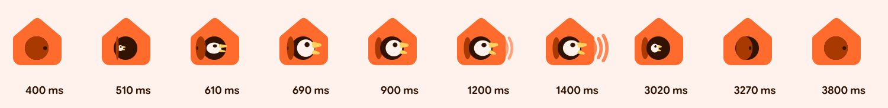

# Cucuto motion language

Everything in Cucuto moves on **springs**, the Material 3 Expressive way: objects have mass, overshoot a little
when they are happy, and settle quickly. Motion explains what happened (a character was assigned, a door
opened); it never makes the user wait. Setting up a contact must still take less than 10 seconds.

Live demo: [`motion/door-open.svg`](motion/door-open.svg) (open it in a browser; it loops, and shows the open door
without motion when the system asks for reduced motion).

## Spring tokens

Use `MaterialExpressiveTheme` with `MotionScheme.expressive()` and always read the springs from
`MaterialTheme.motionScheme`, never hard-code them. The values below are the expressive scheme tokens
(`androidx.compose.material3.tokens.ExpressiveMotionTokens`); the demo and filmstrip are computed with exactly
these numbers.

| Token | Compose | Damping ratio | Stiffness | Feel |
| --- | --- | --- | --- | --- |
| Fast spatial | `motionScheme.fastSpatialSpec()` | 0.6 | 800 | Quick, visible bounce |
| Default spatial | `motionScheme.defaultSpatialSpec()` | 0.8 | 380 | Smooth with a small overshoot |
| Slow spatial | `motionScheme.slowSpatialSpec()` | 0.8 | 200 | Big, calm moves |
| Fast effects | `motionScheme.fastEffectsSpec()` | 1.0 | 3800 | Instant, no bounce |
| Default effects | `motionScheme.defaultEffectsSpec()` | 1.0 | 1600 | No bounce |
| Slow effects | `motionScheme.slowEffectsSpec()` | 1.0 | 800 | Gentle, no bounce |

**Spatial** springs move things: position, size, scale, rotation, shape morphs. **Effects** springs change
properties that must never overshoot: color, opacity, blur, elevation. An opacity that bounces past 1 or a color
that overshoots looks broken, so they are always critically damped.

### Where each one goes

| Interaction | Spring | Notes |
| --- | --- | --- |
| Button, chip, avatar press (shape morph, scale 0.92) | fast spatial | M3 Expressive buttons already do this; use the default `ButtonDefaults.shapes()` |
| Sprite preview bounce in the character picker | fast spatial | Plus squash and stretch (below) |
| The cuckoo door opening, the bird popping out | fast spatial | The signature moment |
| Bird going back in, door closing | default spatial | Calmer exit than entrance |
| Card expand, list item reorder, FAB menu, bottom sheet | default spatial | |
| Shared element grid → detail, screen transitions | default spatial | Predictive back scrubs the same spring. Things attached to a shared element (an avatar's ringtone badge) fly with it as one group, above it the whole way, never popping at the start or end (#339) |
| Hero and onboarding illustrations, carousels settling | slow spatial | |
| Ripple-free state layers, selection color, icon fill | fast effects | |
| Fades in and out, color scheme change to a character's colors | default effects | |
| Background tint changes, scrims | slow effects | |

Durations come from the springs. If a tween is unavoidable (e.g. the web without a spring library), use
Material's emphasized easing and these approximate settle times: fast 200 ms, default 350 ms, slow 500 ms.
On the website, `linear()` CSS easing can approximate the springs.

## The signature: "the door pops open"

A cuckoo clock announces who is there. Whenever Cucuto reveals a character (assign, simulate message,
pack import preview, onboarding success, website hero), the little round door opens and the character pops out.

| t (ms) | Element | What happens | Spring |
| --- | --- | --- | --- |
| 0 | door | Closed: a rust disc with a knob covering the opening | — |
| 450 | door | Swings open around a hinge just inside the left rim: `scaleX` 1 → −0.32 (the negative scale shows its back), overshooting to about −0.44 | fast spatial |
| 550 | bird | Pops out from 35 % scale and 6 units inside, stretching up to 1.2× along the motion as it accelerates, then squashing as it lands | fast spatial |
| 850 | door | Swaps to the "behind the frame" layer once settled, matching the static logo | — |
| 1150 | beak + head | First call, "cu-": lower beak rotates open 22°, upper beak −10°, head squashes 9 % vertically; three sound arcs scale out from the beak | open fast spatial, close default spatial; arcs default effects (opacity) + slow spatial (travel) |
| 1600 | beak + head | Second call, "-cu!" | same |
| 2900 | bird | Goes back in | default spatial |
| 3150 | door | Closes, small settle | default spatial |
| 4200 | — | Loop (demo only; the app plays it once per event) | — |

In the app the bird is the character's sprite clipped to the door opening, with the assign sound
(`sounds/assign.ogg`) on the first beat and the character's own clip right after it. The door color comes from
the character's scheme (`primary`), the house from `primaryContainer`.

## Squash and stretch for sprites

Sprites are static images (often vector art), so Cucuto gives them life with transforms only:

- **Keep the area constant:** `scaleY = 1 / scaleX`. Never scale one axis alone.
- **Stretch along the velocity**, up to 1.2× (`stretch = clamp(velocity × 0.012, −0.2, 0.2)` in grid units/s).
- **Squash on impact or on each sound beat**, 8–10 % for a voice clip, 15 % for a landing. Pivot at the bottom
  center of the sprite so it stays on the ground.
- **Speaking:** while a clip plays, pulse the squash with the clip's loudness envelope (the same envelope the auto
  haptics use), clamped to 6 %. The sprite looks like it is the one talking.
- Return to rest with **fast spatial**; never leave a sprite deformed after the sound ends.
- Rotation wobble on press: ±4° at most, fast spatial.

## Particle burst (assign)

Assigning a character fires a short burst in the character's colors, together with the assign sound and the
rising haptic (see [sound and haptics](sound-and-haptics.md)).

- **Count:** 12–16 particles. **Shapes:** small `MaterialShapes` (Circle, Sunny, Clover4Leaf, Pill), 6–14 dp.
- **Colors:** the character scheme's `primary`, `primaryContainer`, `tertiary`, `tertiaryContainer`.
- **Emission:** from the avatar's center, evenly spread angles with ±10° jitter, initial speed 900–1400 dp/s.
- **Physics:** drag (velocity × 0.9 per frame at 60 Hz equivalent), slight gravity 600 dp/s², spin ±360°/s.
- **Life:** 450–650 ms; scale 0.4 → 1 (fast spatial) then fade out with default effects over the last 200 ms.
- The avatar itself morphs Cookie9Sided → SoftBurst → Cookie9Sided (fast spatial) at the same timestamp.
- Draw on a `Canvas` overlay, no allocations per frame, cap to one burst at a time per avatar.

## Shapes in motion

- Avatars rest as `MaterialShapes.Cookie9Sided`; on press they morph to `SoftBurst` and scale to 0.92
  (fast spatial), and back on release. Use `Morph` from `androidx.graphics.shapes` via `MaterialShapes`.
- Buttons: Expressive defaults (round at rest, squarer when pressed).
- Loading uses `LoadingIndicator` (its built-in shape morphs), never a bare spinner.

## Reduced motion

When the user turns on **Remove animations** (Settings › Accessibility; `ANIMATOR_DURATION_SCALE == 0`) or the
browser reports `prefers-reduced-motion: reduce`:

- Keep **state changes**: the door is shown open, the assigned avatar appears, colors change. Compose animations
  jump to their end values automatically when the duration scale is 0. Cucuto's own "Remove animations" setting
  (Settings › Sound and feel) does the same inside the app by swapping the motion scheme for one that snaps
  (ADR 0041).
- Drop **decorative motion**: no particles, no squash and stretch, no looping demo, no sound arcs, no parallax.
- Replace the door-open sequence by a single cross-fade (default effects) to the open state.
- Sound and haptics still play (they carry meaning), unless the user turned them off.
- `door-open.svg` stops its animation and shows the open pose under `prefers-reduced-motion: reduce`.

## Sync

A single `Feedback` engine fires motion, sound and haptics from one timestamp (see the brief). The visual beat
(door fully open, beak open) lands on the sound's attack within ±16 ms (one frame at 60 Hz).
